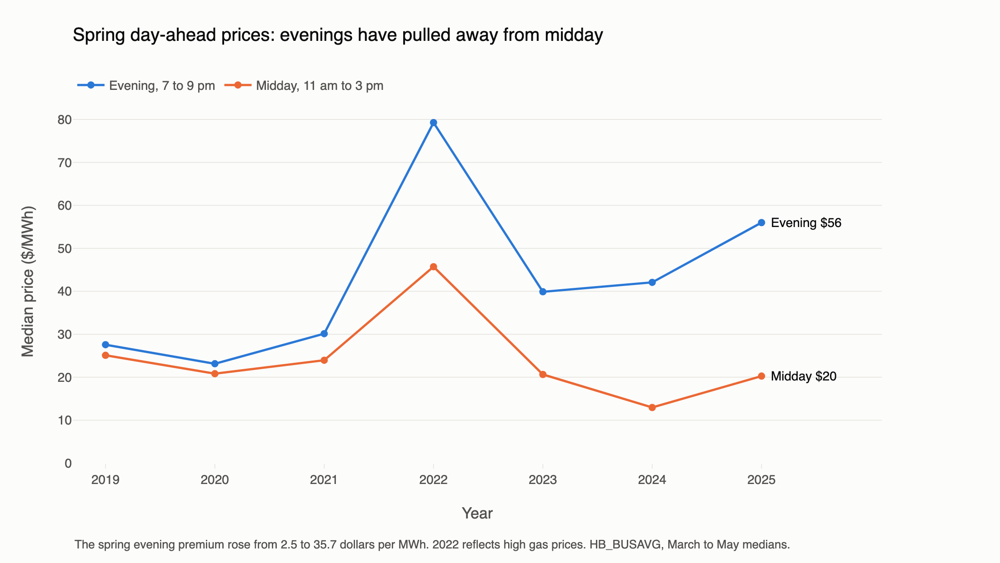

# Texas Grid Load Analysis

How has electricity demand on the Texas grid (ERCOT) changed from 2019 to 2025? How is solar reshaping it, what happened during Winter Storm Uri, does gas price move the generation mix, what are these changes worth at market prices, and how well can hourly load be forecast a day ahead on the same terms as ERCOT's own forecast?

Built with Python, DuckDB SQL, scikit-learn/statsmodels and Plotly on seven years of hourly data (61,368 hours).


## Key findings

| | |
|---|---|
| **Duck curve** | The average daily maximum 3-hour evening ramp in net load (demand minus wind and solar) grew **4.5×**, from **3.1 GW (2019) to 13.8 GW (2025)**. The single steepest ramp rose from 13.4 GW to 30.1 GW. |
| **Weather-adjusted growth** | ERCOT's annual peak rose about 15% from 2019 to 2023 and held nearly flat in 2024 (85.5 GW). Is that growth or hotter summers? At identical weather and calendar, ERCOT load grew **26% from 2019 to 2025 (about 3.9% a year)**, almost exactly the raw 27%, so weather explains essentially none of it. Summer-afternoon load at identical weather grew 18%, *more* than the raw peak (+12% by 2025): the milder summers of 2024–25 hid the growth. The fastest-growing zones from 2020 to 2023 were **Far West (Permian Basin) +58%** and North +46%, against about 10–11% for the Dallas and Houston zones. |
| **Fuel mix** | Coal fell from 20.4% to 13.0% of annual generation while total generation grew 27% (383 to 488 TWh). Gas stayed the largest source (41–47%). Wind plateaued near 24%. |
| **Gas price and fuel switching** | Controlling for net load, month and year, doubling the Henry Hub price cuts gas's share of fossil generation by **1.6 points** (95% CI 0.5–2.6, from a 72% average). The link looks weaker than in 2019 (8.7 points), at 0.9–2.9 points since 2022. Falling coal capacity doesn't explain that: the fade survives capacity and headroom controls, so I report this as descriptive, not causal. |
| **Winter Storm Uri** | Served demand peaked at **69.2 GW in the hour ending 8 pm on Feb 14 2021**. Over the next 54 hours generation fell **38.7% (68.0 to 41.7 GW)**: gas down 15.6 GW, wind 4.8 GW, coal 4.6 GW, nuclear 1.4 GW. EIA's demand fell in step to about 43 GW, because EIA reports *served* demand. **ERCOT's own day-ahead forecast ran up to 28.9 GW above served demand** (peaking at 76.8 GW) and **1,568 GWh above it over Feb 15–18**. That is an upper bound on load shed, since it also includes forecast error and conservation. EIA has no missing hours that week. |
| **Forecast vs ERCOT** | Using only what was known at ERCOT's 9:30 am posting, my model reached **3.05% MAPE** (RMSE 2,238 MWh) on 2024–2025, against **2.38%** for that posting (RMSE 1,810 MWh) and **8.53%** for the same-hour-last-week baseline. ERCOT wins clearly: mine beat it on 30% of days. A hindsight version with actual weather scored 2.52%, so hindsight was worth about half a point. |
| **What drives the model** | Statewide forecast temperature and recent weather matter most, then the temperature over the baseline days and the previous morning's load. |
| **Biggest misses** | The worst days are storm outages (Hurricane Beryl, the May 2024 Houston derecho), which ERCOT also missed, and the January 2024 cold snap, when the temperature forecast ran about 7 °C warm. Skipping holidays in the baseline did not reduce holiday error. |
| **What it's worth** | The spring evening price premium over midday rose from **$2.50 to $35.70/MWh**. West Texas went from a discount to the North hub to at least $5 above it in **28% of hours**. Uri's six worst days total **$47 billion** at day-ahead prices, more than 2.5 times all of 2019. |

## Data sources

| Source | What | Range | Rows |
|---|---|---|---|
| [EIA Open Data API v2](https://www.eia.gov/opendata/), `electricity/rto/region-data` | Hourly ERCOT demand (`type=D`) | 2019-01-01 to 2025-12-31 (UTC) | 61,367 |
| EIA, `electricity/rto/region-data` | **ERCOT's own day-ahead demand forecast** (`type=DF`, as ERCOT files it on Form EIA-930) | same | 61,320 |
| [ERCOT public API](https://apiexplorer.ercot.com), report `NP3-565-CD` | ERCOT's 7-day load forecast by model and weather zone. I keep the **09:30 posting the day before** each delivery day (before the 10:00 day-ahead market), all 8 forecast models | 2024-01-01 to 2025-12-31 | 135,217 |
| EIA, `electricity/rto/fuel-type-data` | Hourly generation by fuel (NG, COL, NUC, WND, SUN, WAT, OTH, BAT, UES) | same | 449,006 |
| EIA, `electricity/rto/region-sub-ba-data` | Hourly load for ERCOT's 8 weather zones | 2019-05-27 onward | 462,405 |
| EIA, `natural-gas/pri/fut` (series `RNGWHHD`) | Daily Henry Hub natural gas spot price, $/MMBtu | 2019-01-02 to 2025-12-31 | 1,755 trading days |
| [Open-Meteo historical archive](https://open-meteo.com/en/docs/historical-weather-api) | Hourly 2 m temperature for 8 cities | same | 490,944 (61,368 per city) |
| [Open-Meteo Previous Runs](https://open-meteo.com/en/docs/previous-runs-api) | Archived GFS and JMA temperature forecasts for 8 cities, predicted 1 to 4 days before each valid hour | 2021-03-24 to 2025-12-31 | 669,696 (both models) |
| [ERCOT report NP4-180-ER](https://www.ercot.com/mp/data-products/data-product-details?id=NP4-180-ER) | Hourly day-ahead settlement prices at the hubs (public, no login) | 2019-01-01 to 2025-12-31 | 306,840 |

**Timestamps** are stored in UTC and converted to `America/Chicago` only for calendar fields. EIA hourly values are **hour-ending**: the row for 17:00 local covers 4–5 pm. A check on solar output confirms it: generation is centred on the hour ending 2 pm, which matches solar noon. Holidays are US federal holidays from the `holidays` package.

**Temperature** is a load-weighted average of 8 cities. Each city stands in for one ERCOT weather zone and is weighted by that zone's share of 2019–2023 load. Only training-period data sets the weights.

| City | Zone | Weight |
|---|---|---:|
| Dallas | North Central | 30.5% |
| Houston | Coast | 28.1% |
| Midland | Far West | 9.6% |
| San Antonio | South Central (split) | 8.3% |
| Austin | South Central (split) | 8.3% |
| Corpus Christi | Southern | 8.2% |
| Tyler | East | 3.8% |
| Lubbock | West | 3.1% |

The North zone (about 2.5% of load) has no city, so weights are renormalised over the other seven zones.

## Schema


`model_hourly` is a wide table with one row per hour. It joins the calendar to demand, generation pivoted by fuel, weighted temperature, ERCOT's forecast and the Henry Hub price (an ASOF join carries Friday's price through the weekend). It adds window-function features: a 7-day rolling average, a 1-hour ramp, lags of 24 h and 168 h, and a 24-hour temperature lag.

## How to run

```bash
python -m venv .venv && source .venv/bin/activate
pip install -r requirements.txt
echo "EIA_KEY=your_key_here" > .env          # free key from eia.gov/opendata
python src/pull_data.py                       # about 5 min, writes data/raw/*.parquet
# ERCOT API (needs a free account at apiexplorer.ercot.com): add ERCOT_SUBSCRIPTION_KEY,
# ERCOT_USERNAME and ERCOT_PASSWORD to .env, then:
python src/pull_ercot.py                      # about 25 min (rate-limited), resumable
python src/run_sql.py                         # builds data/grid.duckdb from sql/01..10
jupyter nbconvert --execute --inplace notebooks/*.ipynb   # run 01 to 07 in order; 06 reads output from 02
```

| Path | Contents |
|---|---|
| `src/pull_data.py` | Paginated EIA pulls (5,000 rows per call) and Open-Meteo pull. `python src/pull_data.py gas forecast` reruns individual parts (`weather_forecast` and `prices` cover the newest pulls). |
| `sql/01_schema.sql` … `sql/10_forecast_compare.sql` | One question per file; the first line of each states it |
| `src/run_sql.py` | Runs the SQL files in order and prints row counts, quality checks and city weights |
| `notebooks/01_sql_analysis.ipynb` | Query results, spot checks, Uri numbers, EXPLAIN ANALYZE timings |
| `notebooks/02_model.ipynb` | The hindsight model: features, temperature validation, baselines, error analysis |
| `notebooks/03_charts.ipynb` | Charts, exported to `charts/*.png` and `charts/*.html` |
| `notebooks/04_gas_prices.ipynb` | Gas price vs fuel mix: quintiles, controlled regression, capacity and headroom tests |
| `notebooks/05_drivers_and_misses.ipynb` | Weather-adjusted growth, hindsight-model diagnostics, the 6 pm heating/AC test |
| `notebooks/06_operational_forecast.ipynb` | The 9:30 am forecast: cross-validation, test scores, peak hours, holiday test, importance, misses |
| `notebooks/07_prices.ipynb` | Evening premium, Uri at market prices, West hub gap |
| `src/op_forecast.py` | Feature rules for the 9:30 am forecast, with no-leak assertions |
| `src/pull_ercot.py` | ERCOT API pull: token login, one request per delivery day, cached per day so it can resume |
| `src/build_notebooks.py` | Generates the notebooks from source |

## Data quality (sql/02_quality.sql)

| Check | Found | What was done |
|---|---|---|
| Missing demand hours | **1**: 2021-11-07 06:00 UTC, the hour clocks fell back for daylight saving | Time-weighted linear interpolation (33,926 MWh), flagged `is_imputed` |
| Missing generation hours | **24**: all of 2025-12-05 (UTC), every fuel | Left NULL; affects only fuel-mix totals for that day |
| Missing ERCOT forecast hours | **48**: Dec 5–7 2025 | Left NULL; dropped from every forecast comparison |
| Missing city-hour temperatures | 0 | — |
| Duplicate rows (demand, generation, forecast, gas price) | 0 | — |
| Demand or forecast < 0 or > 100,000 MWh; gas price ≤ 0 | 0 | — |
| Negative wind or solar | 0 | — |
| Gas misfiled as "Other" | **122 hours** on 5 days, Dec 2019 to Mar 2020: OTH jumps to 9–27 GW while NG drops to near 0 | OTH added back to NG for those hours, flagged `is_reclassified` (total MWh unchanged) |
| Smaller OTH bumps (1.5–4 GW) | 158 hours: 125 on 2024 summer and fall evenings, 32 on Dec 6–15 2025, 1 in 2023 | Left alone. The 2024 hours are most likely battery discharge before EIA split out `BAT` in Nov 2024. The Dec 2025 cluster follows the missing day of Dec 5 and is unexplained. |
| Weather zones don't sum to ERCOT total (more than 2% off) | **2,124 hours**: 9 before 2024, 249 in 2024, 1,866 in 2025 (mostly zones summing about 3.7% high, some hours missing zones) | Left alone. Zones are used only for temperature weights, which come from 2019–2023, where they match. |
| Uri week (Feb 13–20 2021) | No gaps or outliers, but demand is supply-capped | Kept as-is and reported as a finding |
| ERCOT API, daylight saving | ERCOT lists "hour ending 2:00" twice on fall-back days, with a DST flag on the second | Converted from each hour's start time, so the two hours land on different UTC hours. Result: 17,544 hours, no duplicates, exactly one in-use model per hour. |

**Bug fixed in review:** the Uri baseline originally averaged Jan 23–Feb 12. But Feb 10–12 were already near freezing, with demand of 54–64 GW, which inflated the "normal" baseline. It now uses Jan 20–Feb 9.

**Spot checks:** three hours (2021-02-15 06:00, 2023-08-10 23:00, 2025-06-01 18:00 UTC) were checked by hand. Their lag, ramp and solar columns match the raw parquet values exactly.

## Model results

ERCOT posts its day-ahead forecast at 9:30 am the day before delivery, so my headline forecast follows the same rule (`src/op_forecast.py`, `notebooks/06_operational_forecast.ipynb`):
- **Load:** known only through hour ending 9 am the day before. The code asserts this.
- **Weather:** archived forecasts, using the newest run already published at 9:30 am. Each delivery hour uses the 24-hour-old value if that run was out (allowing 4 hours to publish), otherwise the 48-hour-old value. GFS is the main source; JMA fills GFS's archive gap (2023-12-30 to 2024-01-19).
- **Target:** load divided by a baseline, the average of the same hour over the last 14 fully known non-holiday days. A ratio to a moving baseline handles load growth, which tree models can't extrapolate.
- **Other inputs:** calendar, holiday flags, city and load-weighted forecast temperature, the previous morning's load, the last full day's load, and recent weather.

Train 2019–2023 (Uri excluded), test 2024–2025. Before March 2021, training rows use observed temperature plus a fixed offset measured on 2022. Inputs were compared by expanding-window cross-validation over 2022 and 2023, and settings were tuned on 2023 (3.17% to 2.99%). The chosen settings are 500 iterations, learning rate 0.1, 31 leaves and at least 60 samples per leaf, with early stopping off.

| Forecast (same 17,489 test hours) | RMSE (MWh) | MAPE (%) | Bias (MWh) |
|---|---:|---:|---:|
| Baseline: same hour last week | 6,482 | 8.53 | −28 |
| **Mine, 9:30 am information only** | **2,238** | **3.05** | **−304** |
| *ERCOT 9:30 am posting (API, in-use model)* | *1,810* | *2.38* | *+410* |
| ERCOT day-ahead, EIA-930 copy (posting time undocumented) | 1,757 | 2.31 | +418 |
| Reference: mine with hindsight (notebook 02) | 1,971 | 2.52 | +50 |

| | Mine | ERCOT posting |
|---|---:|---:|
| 2024 | 3.14% | 2.24% |
| 2025 | 2.95% | 2.53% |
| Winter | 3.59% | 2.81% |
| Spring | 2.74% | 2.35% |
| Summer | 2.96% | 2.22% |
| Fall | 2.92% | 2.16% |
| Summer, 4 to 8 pm | 3.05% | 2.39% |
| Size of each day's peak | 2.98% | 2.46% |
| Days the peak hour was called exactly | 37% | 59% |

**ERCOT wins in both years, every season and at the peak.** Mine beats it on 30% of days and 40% of hours, and removes about two-thirds of the baseline's error.

**Recent weather (rolling 24 and 72 hour temperature, overnight low).** Buildings hold heat and cold, so these should help. The evidence is uneven: they cut 2022 cross-validated error from 3.65% to 3.34% and left 2023 about the same (3.15% to 3.17%). They stayed in on the pooled score, chosen before the test set was read.

**Holidays: the fix didn't work.** Skipping holidays in the baseline left holiday error at about 4.0% and the two days after at 3.47%, against 3.39% without the fix. ERCOT scored 2.9% on both. Anchoring on a single day a week earlier made holiday-period error worse in validation.

**Humidity isn't in the model.** Open-Meteo archives no dew point or humidity forecasts. Observed dew point would have cut validation error by about 0.15 points, but that would bring back hindsight.

### What drives the model

Grouped permutation importance on the test set, 5 shuffles each. Correlated inputs split the credit, so a low score means an input adds little beyond the others, not that it's irrelevant.

| Input | MAPE rise when shuffled (pts) |
|---|---:|
| Statewide forecast temperature | 2.27 |
| Recent weather | 1.90 |
| Temperature over the baseline days | 1.20 |
| Morning load, day before | 1.14 |
| Day of week | 0.79 |
| Dallas temperature | 0.69 |
| Hour of day | 0.52 |
| Tyler temperature | 0.21 |
| Houston temperature | 0.15 |
| Load two days before | 0.14 |
| Month | 0.13 |
| Other cities, holiday flags | 0.07 or less each |


### The 10 biggest misses (test set, by daily MAPE)

| Date | Mine | ERCOT | Mean error | Context |
|---|---:|---:|---:|---|
| 2024-07-08 | 19.3% | 16.3% | +9.6 GW | Hurricane Beryl landfall near Houston; about 2.2 million customers lost power |
| 2024-01-15 | 14.1% | 4.8% | −10.2 GW | MLK Day, freezing; temperature forecast 6.8 °C warm |
| 2024-05-17 | 10.2% | 10.2% | +4.8 GW | Day after the Houston derecho |
| 2024-01-14 | 9.8% | 6.0% | −5.7 GW | Freezing; temperature forecast 7.0 °C warm |
| 2024-05-28 | 9.7% | 9.0% | +3.6 GW | Day after Memorial Day |
| 2024-07-09 | 9.1% | 9.7% | +4.8 GW | Beryl outages continuing |
| 2024-01-29 | 9.1% | 1.2% | +4.0 GW | No clear driver in the data |
| 2024-05-16 | 8.2% | 5.6% | +1.3 GW | Houston derecho |
| 2024-11-01 | 8.0% | 2.9% | +4.1 GW | No clear driver in the data |
| 2024-06-05 | 7.9% | 8.7% | +3.7 GW | No clear driver in the data |

Beryl and the derecho are labeled by hand; the rest comes from the data. January 14–15 fall in the JMA-filled weeks.

### The hindsight version

The first model (notebook 02) used observed temperature and the previous day's full load. It predicted the change from the same hour yesterday and scored 2.52%. It isn't a fair comparison with ERCOT, but two lessons came from it.

**Why tree models need an anchor.** Gradient boosting that predicts load directly scored 5.70%, worse than the naive "yesterday" forecast (4.51%), because 2024–25 load sits above most of the training range and trees can't extrapolate.

**Bug: load levels as inputs.** That version also fed in yesterday's and last week's load levels. In 2019–23 it learned that high-load days are followed by drops. In 2024–25 load is high every day because of growth, so it kept predicting drops and under-forecast by about 1,000 MWh. Removing them cut error from 2.94% to 2.52%; the change was chosen on the 2023 validation year.

**The 6 pm question.** Hour ending 6 pm was its worst hour, which raised a question: do people get home and switch on heating or AC? A correction fit on 2023 made 6 pm slightly worse (3.04% to 3.10%), and none of its terms was significant, so I didn't add one. Investigating this is what exposed the bug above. See `notebooks/05_drivers_and_misses.ipynb`, section 4.

## Weather-adjusted demand growth

Peak load rose about 15% from 2019 to 2023. To separate growth from weather, `notebooks/05_drivers_and_misses.ipynb` fits log(hourly load) on:
- **Temperature:** cooling and heating degrees and their squares, each with its own effect by hour of day.
- **Calendar:** hour, weekday, month and holidays.
- **A year effect:** the change in load at identical weather and calendar.

Uri and the Beryl outage period are excluded, since load there was lost to outages. R² is 0.96.

| Year | Actual avg load | Weather-adjusted, all hours | Weather-adjusted, summer afternoons | Actual annual peak | Summer cooling degrees |
|---|---:|---:|---:|---:|---:|
| 2019 | — | — | — | — | 10.1 |
| 2020 | −1.0% | +0.3% | −1.4% | −0.5% | 9.5 |
| 2021 | +1.8% | +4.4% | +4.7% | −1.4% | 8.9 |
| 2022 | +12.2% | +9.3% | +6.4% | +7.1% | 10.7 |
| 2023 | +16.5% | +14.9% | +11.7% | +14.6% | 11.7 |
| 2024 | +20.2% | +20.7% | +15.2% | +14.8% | 9.9 |
| 2025 | +27.2% | +26.0% | +18.4% | +12.2% | 9.8 |

All changes are relative to 2019.

- **The growth is structural, not weather.** At identical weather, load is 26% higher than in 2019, about 3.9% a year.
- **Milder summers hid it.** Summers in 2024–25 were milder than 2023, with cooling degrees back near the 2019 level. That's why the *raw* peak stalled even though summer-afternoon load at identical weather kept climbing.
- **The fastest growth is in West Texas.** Comparing full years 2020 to 2023 by zone: Far West, the Permian Basin oil field, rose 58%; North rose 46%; Coast and North Central rose about 10–11%. That pattern is consistent with oil-field electrification and large new industrial loads such as crypto mining and data centers, though this data can't separate them.
- **EIA load is net of rooftop solar,** which grows over time, so growth in underlying consumption is if anything understated.


## Gas prices and the generation mix

Gas and coal compete for the load left after wind, solar and nuclear, so the outcome measure is gas / (gas + coal) by day. Uri (Feb 10–20 2021) is excluded because its price spike to $23.86 came with forced outages, not economic dispatch.

**Raw comparison (`sql/09_gas_price.sql`):** price quintiles are ranked *within each month*, so seasonality and coal retirements don't pose as a price effect. Gas share of fossil generation goes from 72.2% on the cheapest fifth of days to 71.5% on the most expensive.

**Controlled regression (`notebooks/04_gas_prices.ipynb`):** gas share of fossil is regressed on log(price), net load, net load squared, month and year, with Newey-West standard errors. The result: **−1.55 points per doubling of price** (95% CI −2.64 to −0.47). Adding weather or a coal capacity proxy, or using mild days only, gives −1.6 to −2.1.

**Bug fixed:** Newey-West assumes rows are in time order, and the query didn't guarantee it. Sorting by date widened this interval from −2.28 to −0.83.

**By year:**

| Year | Points per doubling | 95% CI (±) | Coal share (avg of days, Uri excluded) |
|---|---:|---:|---:|
| 2019 | −8.7 | 5.7 | 20.5% |
| 2020 | −4.8 | 1.9 | 18.1% |
| 2021 | −3.8 | 6.6 | 19.2% |
| 2022 | −2.7 | 2.6 | 16.9% |
| 2023 | −0.9 | 3.2 | 13.9% |
| 2024 | −2.0 | 2.6 | 12.6% |
| 2025 | −2.9 | 2.0 | 12.9% |

This coal share is the average of daily shares without Uri, so it differs slightly from the annual totals in Key findings (20.4% to 13.0%).

**Why it faded.** There's no fleet capacity in this data, so I built two proxies from earlier days' coal output: peak output over the previous 30 days, and headroom (that peak minus average output).

| Test | Result |
|---|---|
| Price × coal capacity (12.6 GW in 2019, 10.3 GW in 2025) | +0.08 per GW, p = 0.62: no effect |
| Price × headroom | −2.0 per GW, p < 0.001: spare coal means more switching |
| Headroom over time | 3.6 GW in 2019, 3.0 GW in 2025, 4.1 GW in 2024: no clear trend |
| Price × time, with headroom controlled | +0.85 per year, p = 0.005: the fade remains |

So coal retirements don't explain the fade in this data. Weather also moves prices, demand and plant availability together, and Henry Hub isn't the Texas price, so these results are descriptive, not causal.


## What this means

From ERCOT's public day-ahead prices (`notebooks/07_prices.ipynb`, hub average `HB_BUSAVG`, medians, Uri excluded from yearly figures):

| Year | Spring midday | Spring evening | Spring premium | Top-2 minus bottom-2 hours, all year | West minus North hub | Hours West is $5+ above North |
|---|---:|---:|---:|---:|---:|---:|
| 2019 | $25.1 | $27.6 | $2.5 | $28.4 | −$1.4 | 0.2% |
| 2020 | $20.8 | $23.1 | $2.3 | $24.9 | −$2.0 | 0.9% |
| 2021 | $23.9 | $30.1 | $6.2 | $40.0 | −$4.1 | 0.2% |
| 2022 | $45.7 | $79.3 | $33.6 | $66.5 | −$4.8 | 4.5% |
| 2023 | $20.6 | $39.9 | $19.2 | $43.7 | +$1.0 | 19.5% |
| 2024 | $13.0 | $42.1 | $29.1 | $36.2 | +$1.9 | 22.6% |
| 2025 | $20.3 | $56.0 | $35.7 | $46.4 | +$0.8 | 28.2% |

- **Evening flexibility is worth more.** The steeper ramp shows up in prices. The daily top-to-bottom gap is a rough gross margin for a two-hour battery before losses, and more batteries would likely narrow it. 2022 reflects high gas prices.
- **West Texas is a transmission question.** The West hub moved from a discount to a frequent premium, which fits load growing faster than the wires serving it, though prices alone can't prove the cause.
- **Uri at market prices.** February 14–19, 2021 averaged about $6,500/MWh of served demand, against $22 in the three weeks before. That's $47 billion, compared with $18 billion for all of 2019. This is market value, not what customers paid.



## Charts

Each has a static PNG and an interactive HTML version in `charts/`.

| Chart | Takeaway |
|---|---|
| [Load vs temperature](charts/load_vs_temperature.html) | Load is U-shaped in temperature, lowest near 16 °C |
| [Weather-adjusted growth](charts/weather_adjusted_growth.html) | At identical weather, load grew 26% from 2019 to 2025 |
| [Duck curve](charts/duck_curve.html) | Spring midday net load sinks to about 21 GW in 2025; the evening ramp steepens |
| [Winter Storm Uri](charts/uri_week.html) | Generation fell 39% from the peak; ERCOT's forecast ran up to 29 GW above served demand |
| [Gas price switching](charts/gas_price_switching.html) | Gas-to-coal switching looks weaker than in 2019; the cause is unclear |
| [What drives the model](charts/feature_importance.html) | Statewide forecast temperature, then recent weather |
| [Error by season](charts/model_error_by_season.html) | My 9:30 am forecast vs the baseline vs ERCOT's posting |
| [Evening premium](charts/evening_premium.html) | Spring evening prices have pulled away from midday |


## Limitations

- **Weather forecast gaps.** GFS's archive is missing 2023-12-30 to 2024-01-19, so those weeks use JMA, a less accurate model. Hours that can't use the 24-hour-old run use the 48-hour-old run, which understates what was available. Before March 2021, training uses observed temperature plus an offset.
- **Timing assumptions.** Load through 9 am is treated as available by 9:30 am, and a model run as available four hours after it starts.
- **Test set handling.** Notebook runs scored the test set before the last changes (adding recent weather, turning off early stopping), but I did not read those results until the design was final.
- **Two sources for ERCOT's forecast.** The headline comparison uses ERCOT's own API, which has a documented 9:30 am posting but covers only 2024–25 and needs a registered account. The Uri analysis uses the EIA-930 copy, which covers all 7 years but has no documented posting time. The two agree within 0.07 points on 2024–25.
- **ERCOT-wide demand only.** The model forecasts total ERCOT load and does not use the zone data except for temperature weights. Eight cities stand in for statewide weather, and the North zone has no city.
- **Henry Hub is a national price.** Texas plants buy gas at Houston Ship Channel and Waha, and Waha in particular often trades far below Henry Hub. I found no free daily series for either. Coal prices and actual plant availability are not included.
- **EIA demand is served demand.** During load shed (Uri) it understates true demand, so Uri is left out of training for the 9:30 am model.
- **EIA data gaps and coding changes:** a missing generation day (2025-12-05), missing forecast days (Dec 5–7 2025), gas misfiled as OTH (fixed), zone totals that drift in 2024–25, and storage categories (BAT/UES) that only start in Nov 2024.
- **Prices are day-ahead hub prices,** not what customers paid, and the market value figures ignore hedges and real-time settlement.

## Skills

SQL (DuckDB: star schema, window functions, ASOF joins, PIVOT), Python (pandas, scikit-learn, statsmodels), time-series validation, regression with Newey-West errors, Plotly.
