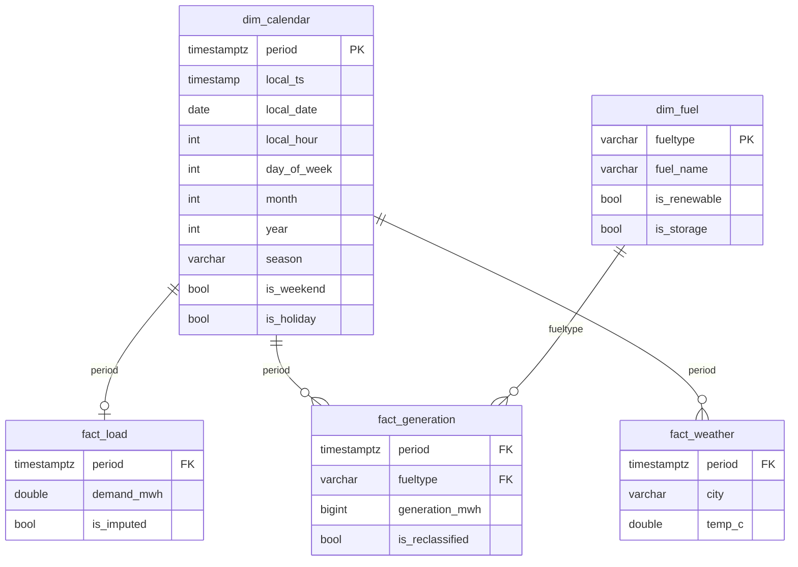
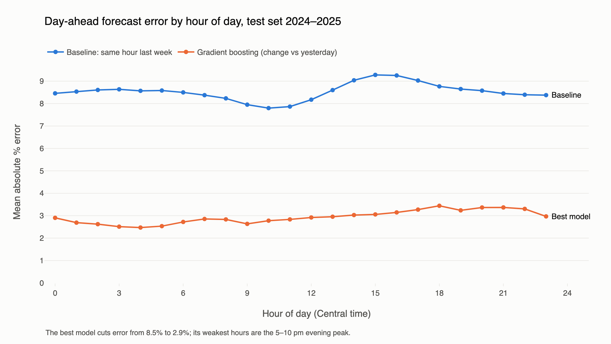

# Texas Grid Load Analysis

How has electricity demand on the Texas grid (ERCOT) changed from 2019 to 2025, how is solar reshaping it, what happened during Winter Storm Uri, and how well can hourly load be forecast a day ahead?

Built with Python, DuckDB SQL, scikit-learn/statsmodels and Plotly on seven years of hourly data (61,368 hours).


## Key findings

| | |
|---|---|
| **Solar at midday** | Solar's share of generation from 11 am to 3 pm rose from **2.5% in 2019 to 32.9% in 2025**. Over the full day it went from 1.0% to 13.8%. |
| **Duck curve** | The average daily maximum 3-hour evening ramp in net load (demand minus wind and solar) grew **4.5×**, from **3.1 GW (2019) to 13.8 GW (2025)**. The single steepest ramp rose from 13.4 GW to 30.1 GW. |
| **Peak load** | Annual peak hourly load rose **14.8%**, from 74.5 GW (2019) to a record **85.5 GW (Aug 20 2024)**. Nearly all the growth came in 2022 (+8.7%) and 2023 (+7.0%). 2025 peaked at 83.6 GW. |
| **Fuel mix** | Coal fell from 20.4% to 13.0% of generation, while total generation grew 27% (383 to 488 TWh). Gas stayed the largest source (41–47%). Wind plateaued near 24%. |
| **Winter Storm Uri** | Served demand peaked at **69.2 GW at 8 pm on Feb 14 2021**. Over the next 54 hours generation fell **38.7% (68.0 to 41.7 GW)**: gas down 15.6 GW, wind 4.8 GW, coal 4.6 GW, nuclear 1.4 GW. EIA's "demand" fell in step to about 43 GW. That is not lower need; it is the **load shed during rolling outages**, because EIA reports served demand. EIA has **no missing hours** that week, so the gap appears only once you know demand is supply-capped. |
| **Forecast** | A day-ahead gradient boosting model reached **2.94% MAPE (RMSE 2,187 MWh)** on 2024–2025, versus **8.53%** for the same-hour-last-week baseline. |

## Data sources

| Source | What | Range | Rows |
|---|---|---|---|
| [EIA Open Data API v2](https://www.eia.gov/opendata/), `electricity/rto/region-data` | Hourly ERCOT demand (`type=D`) | 2019-01-01 to 2025-12-31 (UTC) | 61,367 |
| EIA, `electricity/rto/fuel-type-data` | Hourly ERCOT generation by fuel (NG, COL, NUC, WND, SUN, WAT, OTH, BAT, UES) | same | 449,006 |
| [Open-Meteo historical archive](https://open-meteo.com/en/docs/historical-weather-api) | Hourly 2 m temperature for Dallas, Houston, Austin, San Antonio | same | 245,472 (61,368 per city) |

All timestamps are stored in UTC and converted to `America/Chicago` only for calendar fields such as local hour, weekday and season. Holidays are US federal holidays from the `holidays` package.

## Schema



`model_hourly` is a wide table with one row per hour. It joins the calendar to demand, generation pivoted by fuel, and the average of the four cities' temperatures, and adds window-function features (7-day rolling average, 1-hour ramp, lags of 24 h and 168 h).

## How to run

```bash
python -m venv .venv && source .venv/bin/activate
pip install -r requirements.txt
echo "EIA_KEY=your_key_here" > .env          # free key from eia.gov/opendata
python src/pull_data.py                       # about 2 min, writes data/raw/*.parquet
python src/run_sql.py                         # builds data/grid.duckdb from sql/01..08
jupyter nbconvert --execute --inplace notebooks/*.ipynb   # analysis, model, charts
```

| Path | Contents |
|---|---|
| `src/pull_data.py` | Paginated EIA pulls (5,000 rows per call) and Open-Meteo pull |
| `sql/01_schema.sql` … `sql/08_views.sql` | One question per file; the first line of each states it |
| `src/run_sql.py` | Runs the SQL files in order and prints row counts and quality checks |
| `notebooks/01_sql_analysis.ipynb` | Query results, spot checks, Uri numbers, EXPLAIN ANALYZE timings |
| `notebooks/02_model.ipynb` | Features, time-based split, models, error analysis |
| `notebooks/03_charts.ipynb` | All charts, exported to `charts/*.png` and `charts/*.html` |

## Data quality (sql/02_quality.sql)

| Check | Found | What was done |
|---|---|---|
| Missing demand hours | **1**: 2021-11-07 06:00 UTC, the hour clocks fell back for daylight saving | Linearly interpolated (33,926 MWh) and flagged `is_imputed` |
| Missing generation hours | **24**: all of 2025-12-05 (UTC), every fuel | Left NULL; affects only fuel-mix totals for that day |
| Duplicate rows | 0 | — |
| Demand < 0 or > 100,000 MWh | 0 | — |
| Negative wind or solar | 0 | — |
| Gas misfiled as "Other" | **122 hours** on 5 days, Dec 2019 to Mar 2020: OTH jumps to 9–27 GW while NG drops to near 0 | OTH added back to NG for those hours, flagged `is_reclassified` |
| Smaller OTH bumps (1.5–4 GW) | 158 hours: 125 on 2024 summer and fall evenings, 32 on Dec 6–15 2025, 1 in 2023 | Left alone. The 2024 hours are most likely battery discharge before EIA split out `BAT` in Nov 2024. The Dec 2025 cluster follows the missing day of Dec 5 and is unexplained. |
| Uri week (Feb 13–20 2021) | No gaps or outliers, but demand is supply-capped | Kept as-is and reported as a finding (see above) |

Spot checks: three hours (2021-02-15 06:00, 2023-08-10 23:00, 2025-06-01 18:00 UTC) were checked by hand. Their lag, ramp, solar and average-temperature columns match the raw parquet values exactly.

## Model results

Day-ahead forecast of hourly load. Train on 2019–2023, test on 2024–2025, split by time (never randomly). Every feature is known a day ahead: calendar fields (hour, weekday, month, weekend, holiday), demand 24 h and 168 h earlier, temperature, cooling and heating degrees (base 18.3 °C), temperature squared, and the change in temperature from the same hour yesterday.

| Model | RMSE (MWh) | MAPE (%) |
|---|---:|---:|
| Baseline: same hour last week | 6,480 | 8.53 |
| Reference: same hour yesterday | 3,503 | 4.52 |
| Linear regression (OLS, calendar dummies) | 3,623 | 5.55 |
| Gradient boosting, default settings, predicting load | 3,834 | 5.77 |
| **Gradient boosting, default settings, predicting change vs yesterday** | **2,187** | **2.94** |

Gradient boosting that predicts load directly loses to the naive "yesterday" forecast. Tree models cannot extrapolate, and 2024–25 load sits above most of the training range. Training the same default model on the *change* from the same hour yesterday, then adding back yesterday's load, fixes this and cuts error by two-thirds against the baseline. No hyperparameters were tuned.

**Where it fails** (best model, test set):
- **By season:** winter 3.7%, spring 3.0%, fall 2.6%, summer 2.5%. Cold snaps are hard.
- **By hour:** 2.5% overnight versus about 3.4% during the 5–10 pm evening peak.
- **Holidays:** 4.05% versus 2.90% on other days.
- **Worst days:** **Jul 8 2024 (17.8%)**, when Hurricane Beryl knocked out power to about 2 million Houston customers so load collapsed, and **MLK Day in both 2024 and 2025 (15.6%, 12.8%)**, holidays that fell during Arctic cold snaps.



## Charts

Each has a static PNG and an interactive HTML version in `charts/`.

| Chart | Takeaway |
|---|---|
| [Load vs temperature](charts/load_vs_temperature.html) | Load is U-shaped in temperature, lowest near 17 °C |
| [Midday solar share](charts/midday_solar_share.html) | 2.5% to 32.9% of midday generation in six years |
| [Peak load by year](charts/peak_load_by_year.html) | +14.8% to an 85.5 GW record in 2024 |
| [Duck curve](charts/duck_curve.html) | Spring midday net load sinks to about 21 GW in 2025; the evening ramp steepens |
| [Winter Storm Uri](charts/uri_week.html) | Generation down 39% from the Feb 14 peak; demand capped by outages |
| [Error by hour](charts/model_error_by_hour.html) / [by season](charts/model_error_by_season.html) | Best model's error is about a third of the baseline's at every hour |


## Limitations

- **Observed weather stands in for a forecast.** The model uses observed temperature where a real day-ahead system would use a weather forecast, so real-world error would be higher than 2.94%.
- **The 24-hour lag is a simplification.** Treating the same hour yesterday as known a day ahead assumes the forecast is issued at the end of each hour. An operator issuing at 10 am would not yet know yesterday's evening hours.
- **ERCOT-wide demand only.** There is no breakdown by weather zone or customer class, and four-city average temperature stands in for the whole state.
- **EIA demand is served demand.** During load shed (Uri) it understates true demand, and those hours stay in the 2021 training data.
- **EIA data gaps and coding changes:** a missing generation day (2025-12-05), gas misfiled as OTH (fixed), and storage categories (BAT/UES) that only start in Nov 2024.
- **No price data,** so the analysis cannot say what the ramps or Uri cost.

## SQL techniques used

- **Joins:** LEFT JOIN against a generated hour spine for gap detection; a self-join on weekday and hour for the Uri baseline; star-schema joins of facts to `dim_calendar` and `dim_fuel`.
- **CTEs:** multi-step `WITH` pipelines in the model table, peak growth, fuel share and Uri queries.
- **Window functions:** `AVG … ROWS BETWEEN 167 PRECEDING` (7-day rolling average), `LAG` (1 h ramp, 24 h and 168 h lags, 3 h net-load ramp, year-over-year growth), `RANK() OVER (PARTITION BY year)` (top peaks and ramps), `LAST_VALUE/FIRST_VALUE … IGNORE NULLS` (interpolation), and a windowed `SUM … FILTER` for fuel shares.
- **Conditional aggregation:** `SUM(CASE WHEN fueltype = 'SUN' …)` to pivot fuels into columns.
- **Generated series:** `generate_series` over timestamps to build the calendar dimension.
- **Views:** `daily_peak`, `fuel_mix_yearly` and `net_load_hourly`.
- **Performance:** `EXPLAIN ANALYZE` on DuckDB 2.0 (median of 5 runs): the 7-day rolling window over 61k rows took **4.2 ms**; the Uri weekday-and-hour self-join took **1.7 ms**.
