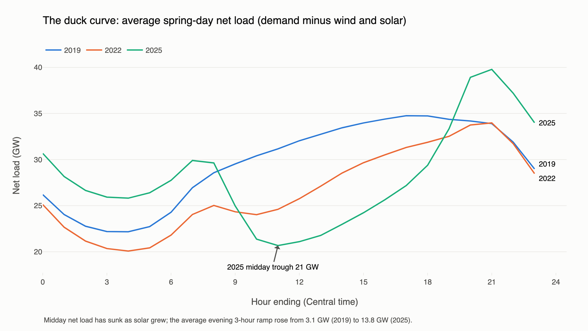
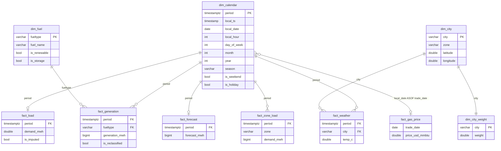
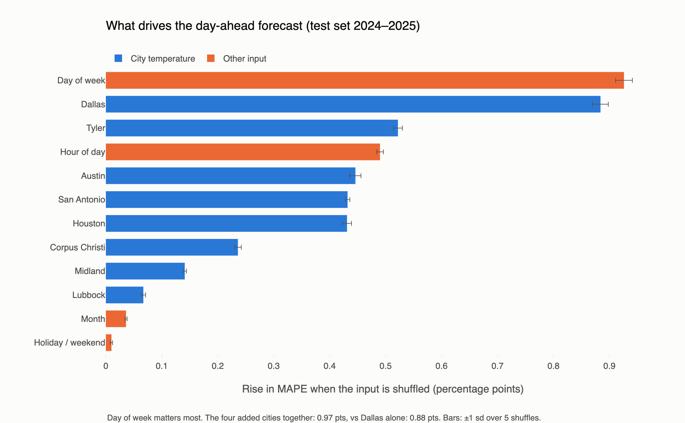
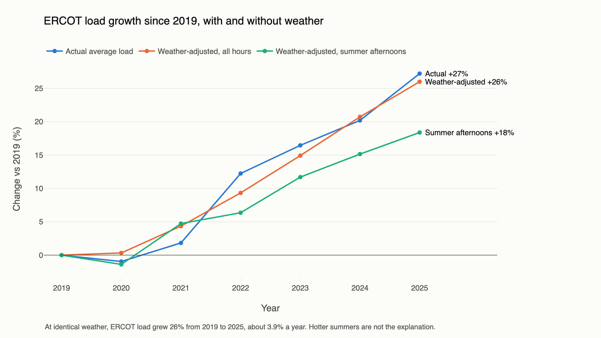
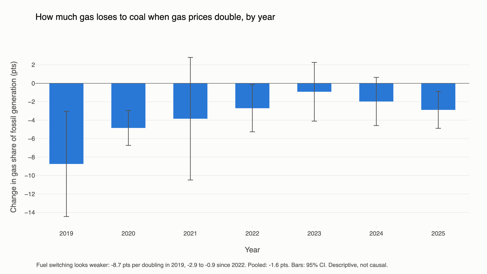
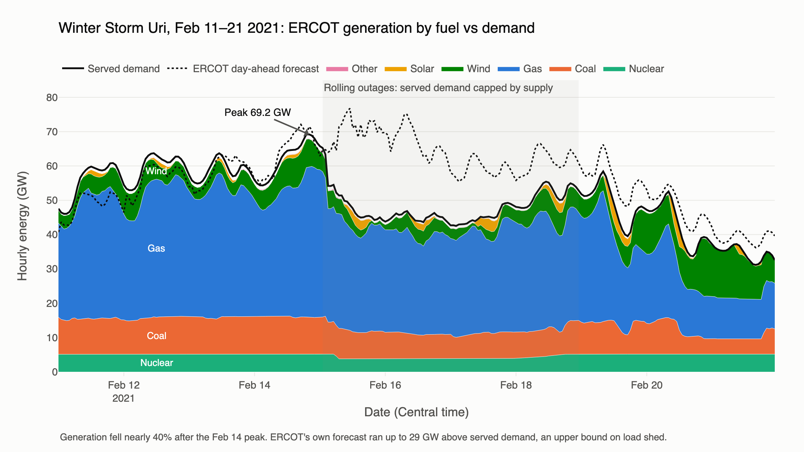

# Texas Grid Load Analysis

How has electricity demand on the Texas grid (ERCOT) changed from 2019 to 2025? How is solar reshaping it, what happened during Winter Storm Uri, does gas price move the generation mix, and how well can hourly load be forecast a day ahead compared with ERCOT's own forecast?

Built with Python, DuckDB SQL, scikit-learn/statsmodels and Plotly on seven years of hourly data (61,368 hours).



## Key findings

| | |
|---|---|
| **Duck curve** | The average daily maximum 3-hour evening ramp in net load (demand minus wind and solar) grew **4.5×**, from **3.1 GW (2019) to 13.8 GW (2025)**. The single steepest ramp rose from 13.4 GW to 30.1 GW. |
| **Weather-adjusted growth** | ERCOT's annual peak rose about 15% to an 85.5 GW record in 2024. Is that growth or hotter summers? At identical weather and calendar, ERCOT load grew **26% from 2019 to 2025 (about 3.9% a year)**, almost exactly the raw 27%, so weather explains essentially none of it. Summer-afternoon load at identical weather grew 18%, *more* than the raw peak (+12% by 2025): the milder summers of 2024–25 hid the growth. The fastest-growing zones from 2020 to 2023 were **Far West (Permian Basin) +58%** and North +46%, against about 10–11% for the Dallas and Houston zones. |
| **Fuel mix** | Coal fell from 20.4% to 13.0% of generation while total generation grew 27% (383 to 488 TWh). Gas stayed the largest source (41–47%). Wind plateaued near 24%. |
| **Gas price and fuel switching** | Controlling for net load, month and year, doubling the Henry Hub price cuts gas's share of fossil generation by only **1.6 points** (95% CI 0.8–2.3, from a 72% average). Switching has **faded**: 8.7 points per doubling in 2019, 0.9–2.9 points since 2022, as coal fell from 20.5% to 12.9% of generation and the remaining plants already run near full output. |
| **Winter Storm Uri** | Served demand peaked at **69.2 GW in the hour ending 8 pm on Feb 14 2021**. Over the next 54 hours generation fell **38.7% (68.0 to 41.7 GW)**: gas down 15.6 GW, wind 4.8 GW, coal 4.6 GW, nuclear 1.4 GW. EIA's demand fell in step to about 43 GW, because EIA reports *served* demand. **ERCOT's own day-ahead forecast ran up to 28.9 GW above served demand** (peaking at 76.8 GW) and **1,568 GWh above it over Feb 15–18**. That is an upper bound on load shed, since it also includes forecast error and conservation. EIA has no missing hours that week. |
| **Forecast vs ERCOT** | Our day-ahead model reached **2.52% MAPE** (RMSE 1,971 MWh) on 2024–2025, against **8.52%** for the same-hour-last-week baseline. **ERCOT's official forecast scored 2.31%** (RMSE 1,756 MWh) on the same hours. ERCOT wins overall, but ours won on **46% of days** and edged it in 2025 (2.41% vs 2.46%) and in summer. Caveat: our model uses actual weather, and ERCOT had to use forecasts. The result holds on ERCOT's own API (its 9:30 am day-before posting: 2.38%). |
| **What drives the model** | Day of week and Dallas temperature matter most, then Tyler, hour of day, and Austin, San Antonio and Houston temperatures. The four added cities together (0.97 pts) matter more than Dallas alone (0.88). Testing the 6 pm theory exposed a bug: load-level inputs made the model under-forecast by about 1,000 MWh. Removing them cut error from 2.94% to 2.52%. |
| **Biggest misses** | The worst days are Hurricane Beryl, cold-snap holidays (MLK Day 2024 and 2025) and sudden warm-ups after cold snaps (Jan 18–19, 2024). The holiday flag barely registers in the model (about 10 holidays a year to learn from): holiday MAPE is 3.93% against 2.48%. The theory that 6 pm heating or AC on workdays needs a correction was tested and rejected. |

## Data sources

| Source | What | Range | Rows |
|---|---|---|---|
| [EIA Open Data API v2](https://www.eia.gov/opendata/), `electricity/rto/region-data` | Hourly ERCOT demand (`type=D`) | 2019-01-01 to 2025-12-31 (UTC) | 61,367 |
| EIA, `electricity/rto/region-data` | **ERCOT's own day-ahead demand forecast** (`type=DF`, as ERCOT files it on Form EIA-930) | same | 61,320 |
| [ERCOT public API](https://apiexplorer.ercot.com), report `NP3-565-CD` | ERCOT's 7-day load forecast by model and weather zone. We keep the **09:30 posting the day before** each delivery day (before the 10:00 day-ahead market), all 8 forecast models | 2024-01-01 to 2025-12-31 | 135,217 |
| EIA, `electricity/rto/fuel-type-data` | Hourly generation by fuel (NG, COL, NUC, WND, SUN, WAT, OTH, BAT, UES) | same | 449,006 |
| EIA, `electricity/rto/region-sub-ba-data` | Hourly load for ERCOT's 8 weather zones | 2019-05-27 onward | 462,405 |
| EIA, `natural-gas/pri/fut` (series `RNGWHHD`) | Daily Henry Hub natural gas spot price, $/MMBtu | 2019-01-02 to 2025-12-31 | 1,755 trading days |
| [Open-Meteo historical archive](https://open-meteo.com/en/docs/historical-weather-api) | Hourly 2 m temperature for 8 cities | same | 490,944 (61,368 per city) |

**Timestamps** are stored in UTC and converted to `America/Chicago` only for calendar fields. EIA hourly values are **hour-ending**: the row for 17:00 local covers 4–5 pm. A check on solar output confirms it: generation is centred on the hour ending 2 pm, which matches solar noon. Holidays are US federal holidays from the `holidays` package.

**Temperature** is a load-weighted average of 8 cities. Each city stands in for one ERCOT weather zone and is weighted by that zone's share of 2019–2023 load. Only training-period data sets the weights.

| City | Zone | Weight |
|---|---|---:|
| Dallas | North Central | 30.5% |
| Houston | Coast | 28.1% |
| Midland | Far West | 9.6% |
| San Antonio | South Central (split) | 8.3% |
| Austin | South Central (split) | 8.3% |
| Corpus Christi | Southern | 8.2% |
| Tyler | East | 3.8% |
| Lubbock | West | 3.1% |

The North zone (about 2.5% of load) has no city, so weights are renormalised over the other seven zones.

## Schema



`model_hourly` is a wide table with one row per hour. It joins the calendar to demand, generation pivoted by fuel, weighted temperature, ERCOT's forecast and the Henry Hub price (an ASOF join carries Friday's price through the weekend). It adds window-function features: a 7-day rolling average, a 1-hour ramp, lags of 24 h and 168 h, and a 24-hour temperature lag.

## How to run

```bash
python -m venv .venv && source .venv/bin/activate
pip install -r requirements.txt
echo "EIA_KEY=your_key_here" > .env          # free key from eia.gov/opendata
python src/pull_data.py                       # about 5 min, writes data/raw/*.parquet
# ERCOT API (needs a free account at apiexplorer.ercot.com): add ERCOT_SUBSCRIPTION_KEY,
# ERCOT_USERNAME and ERCOT_PASSWORD to .env, then:
python src/pull_ercot.py                      # about 25 min (rate-limited), resumable
python src/run_sql.py                         # builds data/grid.duckdb from sql/01..10
jupyter nbconvert --execute --inplace notebooks/*.ipynb   # run in order 01 to 05
```

| Path | Contents |
|---|---|
| `src/pull_data.py` | Paginated EIA pulls (5,000 rows per call) and Open-Meteo pull. `python src/pull_data.py gas forecast` reruns individual parts. |
| `sql/01_schema.sql` … `sql/10_forecast_compare.sql` | One question per file; the first line of each states it |
| `src/run_sql.py` | Runs the SQL files in order and prints row counts, quality checks and city weights |
| `notebooks/01_sql_analysis.ipynb` | Query results, spot checks, Uri numbers, EXPLAIN ANALYZE timings |
| `notebooks/02_model.ipynb` | Features, temperature validation, models, head-to-head comparison with ERCOT, error analysis |
| `notebooks/03_charts.ipynb` | Charts, exported to `charts/*.png` and `charts/*.html` |
| `notebooks/04_gas_prices.ipynb` | Gas price vs fuel mix: quintiles and a controlled regression |
| `notebooks/05_drivers_and_misses.ipynb` | Weather-adjusted growth, per-city feature importance, the 10 biggest misses, the 6 pm heating/AC test |
| `src/pull_ercot.py` | ERCOT API pull: token login, one request per delivery day, cached per day so it can resume |
| `src/build_notebooks.py` | Generates the notebooks from source |

## Data quality (sql/02_quality.sql)

| Check | Found | What was done |
|---|---|---|
| Missing demand hours | **1**: 2021-11-07 06:00 UTC, the hour clocks fell back for daylight saving | Time-weighted linear interpolation (33,926 MWh), flagged `is_imputed` |
| Missing generation hours | **24**: all of 2025-12-05 (UTC), every fuel | Left NULL; affects only fuel-mix totals for that day |
| Missing ERCOT forecast hours | **48**: Dec 5–7 2025 | Left NULL; dropped from every forecast comparison |
| Missing city-hour temperatures | 0 | — |
| Duplicate rows (demand, generation, forecast, gas price) | 0 | — |
| Demand or forecast < 0 or > 100,000 MWh; gas price ≤ 0 | 0 | — |
| Negative wind or solar | 0 | — |
| Gas misfiled as "Other" | **122 hours** on 5 days, Dec 2019 to Mar 2020: OTH jumps to 9–27 GW while NG drops to near 0 | OTH added back to NG for those hours, flagged `is_reclassified` (total MWh unchanged) |
| Smaller OTH bumps (1.5–4 GW) | 158 hours: 125 on 2024 summer and fall evenings, 32 on Dec 6–15 2025, 1 in 2023 | Left alone. The 2024 hours are most likely battery discharge before EIA split out `BAT` in Nov 2024. The Dec 2025 cluster follows the missing day of Dec 5 and is unexplained. |
| Weather zones don't sum to ERCOT total (more than 2% off) | **2,124 hours**: 9 before 2024, 249 in 2024, 1,866 in 2025 (mostly zones summing about 3.7% high, some hours missing zones) | Left alone. Zones are used only for temperature weights, which come from 2019–2023, where they match. |
| Uri week (Feb 13–20 2021) | No gaps or outliers, but demand is supply-capped | Kept as-is and reported as a finding |
| ERCOT API, daylight saving | ERCOT lists "hour ending 2:00" twice on fall-back days, with a DST flag on the second | Converted from each hour's start time, so the two hours land on different UTC hours. Result: 17,544 hours, no duplicates, exactly one in-use model per hour. |

**Bug fixed in review:** the Uri baseline originally averaged Jan 23–Feb 12. But Feb 10–12 were already near freezing, with demand of 54–64 GW, which inflated the "normal" baseline. It now uses Jan 20–Feb 9.

**Spot checks:** three hours (2021-02-15 06:00, 2023-08-10 23:00, 2025-06-01 18:00 UTC) were checked by hand. Their lag, ramp and solar columns match the raw parquet values exactly.

## Model results

Day-ahead forecast of hourly load. Train on 2019–2023, test on 2024–2025, split by time. The main model predicts the **change from the same hour yesterday**, then adds yesterday's load back. Its inputs are all known a day ahead:
- **Calendar:** hour, weekday, month, weekend and holiday flags.
- **Temperature:** temperature, cooling and heating degrees (base 18.3 °C), temperature squared, and the change in temperature from the same hour yesterday.

Yesterday's load is used only as that anchor, not as an input (see below). All rows use the same 17,496 test hours; the 48 with no ERCOT forecast are dropped.

| Model | RMSE (MWh) | MAPE (%) |
|---|---:|---:|
| Baseline: same hour last week | 6,481 | 8.52 |
| Reference: same hour yesterday | 3,500 | 4.51 |
| Linear regression (OLS, calendar dummies) | 3,604 | 5.56 |
| Gradient boosting, default settings, predicting load | 3,733 | 5.70 |
| **Gradient boosting, default settings, predicting change vs yesterday** | **1,971** | **2.52** |
| *ERCOT official day-ahead forecast* | *1,756* | *2.31* |

**Why the change-vs-yesterday target:** gradient boosting that predicts load directly loses to the naive "yesterday" forecast. Tree models cannot extrapolate, and 2024–25 load sits above most of the training range. Training the same default model on the change from yesterday fixes this. No hyperparameters were tuned.

**Bug found and fixed: load levels as inputs.** The first version also fed yesterday's and last week's load *levels* in as inputs. In 2019–23 the model learned that unusually high-load days tend to be followed by drops. In 2024–25 load is high every day because of growth, so it kept predicting drops that never came.

| | 2023 validation MAPE | Test MAPE | Test bias | Test, hour ending 6 pm |
|---|---:|---:|---:|---:|
| With load-level inputs (first version) | 2.92% | 2.94% | under by 1,033 MWh | 3.44% |
| **Without (current)** | **2.65%** | **2.52%** | **over by 54 MWh** | **3.04%** |

The change was chosen on the 2023 validation year, not the test set. It was found while testing the 6 pm theory below.

**Which temperature (decided on the 2023 validation year, never the test set):**

| Temperature input | MAPE | RMSE (MWh) |
|---|---:|---:|
| 4 cities, simple average | 2.65% | 1,878 |
| 8 cities, simple average | 2.74% | 1,914 |
| 8 cities, load-weighted (used) | 2.65% | 1,871 |

Adding the four smaller cities with equal weight makes the forecast worse. Load-weighted, the 8 cities tie the original four on MAPE and have the lowest RMSE.

**Against ERCOT.** ERCOT's forecast is better overall (2.31% vs 2.52%), but the gap is small:

| | Ours | ERCOT |
|---|---:|---:|
| 2024 | 2.63% | 2.16% |
| 2025 | **2.41%** | 2.46% |
| Winter | 3.2% | 2.8% |
| Spring | 2.6% | 2.3% |
| Summer | **2.1%** | 2.2% |
| Fall | 2.2% | 2.0% |

- **Head to head:** ours wins on 46% of days and 48% of hours.
- **Where we edge ERCOT:** 2025 and summer.
- **Bias:** ERCOT runs high by 417 MWh on average; ours runs high by 51 MWh.
- **Don't read this as "better than ERCOT".** Our model sees *actual* temperatures and yesterday's late-evening load. ERCOT had to use weather forecasts and publishes before yesterday's evening is over. With forecast weather, our error would rise. The fair claim is: within 0.2 points of the grid operator's forecast, with hindsight on the weather.

### Check: ERCOT's own API

The headline compares against the EIA copy of ERCOT's forecast, because it covers all seven years with one consistent source. As a check, `src/pull_ercot.py` pulls ERCOT's forecast directly from ERCOT's API: the 09:30 Central posting on the day before each delivery day, the last one before the day-ahead market closes, for every forecast model.

| Forecast (same 17,489 test hours) | RMSE (MWh) | MAPE (%) |
|---|---:|---:|
| ERCOT day-ahead forecast, EIA-930 copy (headline) | 1,757 | 2.31 |
| ERCOT 9:30 am posting, in-use model (ERCOT API) | 1,810 | 2.38 |
| Ours | 1,971 | 2.52 |
| Baseline: same hour last week | 6,482 | 8.53 |

**The conclusion holds on both sources.** The EIA copy scores slightly better and differs by about 465 MWh per hour on average, consistent with it being a later posting.

**ERCOT's own forecast models (API, 2024–25):**

| Model | MAPE | Share of hours in use |
|---|---:|---:|
| X (from Aug 2024 only) | 2.08% | 10% |
| M | 2.25% | 5% |
| The in-use pick | 2.39% | — |
| E3 | 2.58% | 21% |
| E | 2.60% | 28% |
| A3 | 2.62% | 0.1% |
| A6 | 2.71% | — |
| E2 | 2.72% | 18% |
| E1 | 2.77% | 17% |

With hindsight, ERCOT's choice of model each day did worse than always using M. To be fair to ERCOT, the choice is made without hindsight.

**By weather zone,** the in-use forecast misses big zones by 3.6–4.0% and small ones by much more: East 5.7%, North 6.4%, West 9.6%.

**A blend, with a caveat.** A weighted average of 40% ours and 60% ERCOT (weight fit on 2024, scored on 2025) reaches 2.06% MAPE in 2025, against 2.53% for ERCOT alone and 2.41% for ours. **This is not a fair test.** Our model has the hindsight described above, so the gain is mostly that hindsight leaking in. It does not show the model would improve ERCOT's operational forecast.

### What drives the model

The same model was retrained with each of the 8 cities' temperatures as separate inputs, instead of the weighted average. Each group of inputs was then shuffled on the test set to see how much accuracy falls (grouped permutation importance, 5 shuffles each).

| Input | MAPE rise when shuffled (pts) |
|---|---:|
| Day of week | 0.93 |
| Dallas temperature | 0.88 |
| Tyler temperature | 0.52 |
| Hour of day | 0.49 |
| Austin temperature | 0.45 |
| San Antonio temperature | 0.43 |
| Houston temperature | 0.43 |
| Corpus Christi temperature | 0.24 |
| Midland temperature | 0.14 |
| Lubbock temperature | 0.07 |
| Month | 0.04 |
| Holiday / weekend flags | 0.01 |

- **The four added cities pull their weight.** Together they score 0.97, more than Dallas alone (0.88). Tyler, in East Texas, ranks third overall. It may be picking up weather fronts arriving from the east and north, though this test can't prove why.
- **Separate city temperatures score 2.48%,** slightly better than the weighted average's 2.52%. That's a test-set comparison, so it is reported but was not used to switch models.
- **Correlated cities split the credit.** City temperatures move together, so a modest score means "adds little the other cities don't already carry", not "irrelevant".



### The 10 biggest misses (test set, by daily MAPE)

The context column is generated from the data (holidays, the day after a holiday, freezing or extreme heat, temperature swings from the day before), except Hurricane Beryl.

| Date | Day | Ours | ERCOT | Worst hour (error) | Context |
|---|---|---:|---:|---|---|
| 2024-07-08 | Mon | 14.9% | 15.4% | noon (+14.2 GW) | Hurricane Beryl landfall near Houston; about 2.2 million customers lost power |
| 2024-01-15 | Mon | 14.3% | 4.8% | 7 am (−22.9 GW) | MLK Day, freezing (low −7 °C) |
| 2024-01-18 | Thu | 13.8% | 7.0% | 9 pm (+8.7 GW) | Temperature swung up to 12 °C from the day before |
| 2024-11-05 | Tue | 10.1% | 2.2% | noon (+8.6 GW) | No clear driver in our data |
| 2024-01-19 | Fri | 9.3% | 6.5% | 5 am (+8.8 GW) | Near freezing, a 12 °C swing from the day before |
| 2024-11-01 | Fri | 9.2% | 2.7% | 5 pm (+7.5 GW) | No clear driver in our data |
| 2025-01-20 | Mon | 9.1% | 2.8% | 6 pm (−10.9 GW) | MLK Day, freezing (low −4 °C) |
| 2025-01-02 | Thu | 8.8% | 1.8% | 10 am (−6.5 GW) | Day after New Year's Day (the model anchors on holiday-level load) |
| 2025-05-26 | Mon | 8.5% | 7.8% | 4 pm (+7.8 GW) | Memorial Day |
| 2025-06-13 | Fri | 8.4% | 2.6% | 8 pm (−11.0 GW) | No clear driver in our data |

**Patterns in the misses:**
- **Sudden weather swings.** Jan 18–19, 2024 followed an Arctic cold snap. Temperatures jumped 12 °C, load fell faster than the model expected, and it over-forecast.
- **Holidays.** Four of the ten are a holiday or the day after one. The model anchors on yesterday's load, and the holiday flag carries almost no weight (0.01 points above), since there are only about 10 holidays a year to learn from. Holiday MAPE is 3.93%, against 2.48% on other days.
- **Beryl is the one day ERCOT also missed badly.** Outages took load away from both forecasts.
- **ERCOT handles holidays and swings much better,** at 1.8–7.0% on those days against our 8.5–14.3%.

**Where our model fails, by group:**

| Breakdown | Our MAPE |
|---|---:|
| Winter | 3.2% |
| Spring | 2.6% |
| Fall | 2.2% |
| Summer | 2.1% |
| Holidays | 3.93% |
| Other days | 2.48% |

### The 6 pm question: heating and AC when people get home?

Hour ending 6 pm was the first model's worst hour. The theory: on workdays, people get home and switch on heating in winter or AC in summer, so a 6 pm correction for cold or hot workday evenings should help (`notebooks/05_drivers_and_misses.ipynb`, section 4).

**How it was tested:**
1. Train on 2019–2022 and take the model's 6 pm errors in 2023.
2. Regress those errors on heating degrees, cooling degrees, a workday flag and their interactions.
3. Apply the fitted correction to the 2024–25 forecasts.

**Results:**
- **Most of the 6 pm problem was the level-input bug above.** Fixing it cut 6 pm error from 3.44% to 3.04%, and 6 pm is no longer the worst hour.
- **The workday theory isn't supported.** In 2023 none of the heating, AC or workday terms is close to significant (p = 0.25–0.91).
- **In 2024–25 the pattern runs the other way.** Cold and heat raise 6 pm errors on **weekends and holidays** (heating +191 MWh per °C, p = 0.003; AC +64 MWh per °C, p = 0.007), and the workday interactions cancel them out. People do run more heating and AC in the evening, but on days they're home, not the commute. It doesn't show up in 2023, so it isn't stable.
- **The correction makes things worse.** Fit on 2023 and applied to 2024–25, the heating/AC × workday correction raises 6 pm error from 3.04% to 3.10%, and a 5–8 pm version raises it from 2.87% to 2.92%. A constant adjustment changes nothing.

**Conclusion:** no 6 pm coefficient was added.

## Weather-adjusted demand growth

Peak load rose 15% to the 2024 record. To separate growth from weather, `notebooks/05_drivers_and_misses.ipynb` fits log(hourly load) on:
- **Temperature:** cooling and heating degrees and their squares, each with its own effect by hour of day.
- **Calendar:** hour, weekday, month and holidays.
- **A year effect:** the change in load at identical weather and calendar.

Uri and the Beryl outage period are excluded, since load there was lost to outages. R² is 0.96.

| Year | Actual avg load | Weather-adjusted, all hours | Weather-adjusted, summer afternoons | Actual annual peak | Summer cooling degrees |
|---|---:|---:|---:|---:|---:|
| 2019 | — | — | — | — | 10.1 |
| 2020 | −1.0% | +0.3% | −1.4% | −0.5% | 9.5 |
| 2021 | +1.8% | +4.4% | +4.7% | −1.4% | 8.9 |
| 2022 | +12.2% | +9.3% | +6.4% | +7.1% | 10.7 |
| 2023 | +16.5% | +14.9% | +11.7% | +14.6% | 11.7 |
| 2024 | +20.2% | +20.7% | +15.2% | +14.8% | 9.9 |
| 2025 | +27.2% | +26.0% | +18.4% | +12.2% | 9.8 |

All changes are relative to 2019.

- **The growth is structural, not weather.** At identical weather, load is 26% higher than in 2019, about 3.9% a year.
- **Milder summers hid it.** Summers in 2024–25 were milder than 2023, with cooling degrees back near the 2019 level. That's why the *raw* peak stalled even though summer-afternoon load at identical weather kept climbing.
- **The fastest growth is in West Texas.** Comparing full years 2020 to 2023 by zone: Far West, the Permian Basin oil field, rose 58%; North rose 46%; Coast and North Central rose about 10–11%. That pattern is consistent with oil-field electrification and large new industrial loads such as crypto mining and data centers, though this data can't separate them.
- **EIA load is net of rooftop solar,** which grows over time, so growth in underlying consumption is if anything understated.



## Gas prices and the generation mix

Gas and coal compete for the load left after wind, solar and nuclear, so the outcome measure is gas / (gas + coal) by day. Uri (Feb 10–20 2021) is excluded because its price spike to $23.86 came with forced outages, not economic dispatch.

**Raw comparison (`sql/09_gas_price.sql`):** price quintiles are ranked *within each month*, so seasonality and coal retirements don't pose as a price effect. Gas share of fossil generation goes from 72.2% on the cheapest fifth of days to 71.5% on the most expensive.

**Controlled regression (`notebooks/04_gas_prices.ipynb`):** gas share of fossil is regressed on log(price), net load, net load squared, month and year, with Newey-West standard errors. The result: **−1.55 points per doubling of price** (95% CI −2.28 to −0.83).

**By year, the effect has faded:**

| Year | Points per doubling | Coal share (avg of days, Uri excluded) |
|---|---:|---:|
| 2019 | −8.7 | 20.5% |
| 2020 | −4.8 | 18.1% |
| 2021 | −3.8 (wide CI) | 19.2% |
| 2022 | −2.7 | 16.9% |
| 2023 | −0.9 | 13.9% |
| 2024 | −2.0 | 12.6% |
| 2025 | −2.9 | 12.9% |

With less coal left, and what remains already running near full output, there is little room to switch away from gas when it gets expensive.



## Charts

Each has a static PNG and an interactive HTML version in `charts/`.

| Chart | Takeaway |
|---|---|
| [Load vs temperature](charts/load_vs_temperature.html) | Load is U-shaped in temperature, lowest near 16 °C |
| [Weather-adjusted growth](charts/weather_adjusted_growth.html) | At identical weather, load grew 26% from 2019 to 2025 |
| [Duck curve](charts/duck_curve.html) | Spring midday net load sinks to about 21 GW in 2025; the evening ramp steepens |
| [Winter Storm Uri](charts/uri_week.html) | Generation fell 39% from the peak; ERCOT's forecast ran up to 29 GW above served demand |
| [Gas price switching](charts/gas_price_switching.html) | Gas-to-coal switching has faded since 2019 |
| [What drives the model](charts/feature_importance.html) | Yesterday's load, then Dallas and Austin temperature |
| [Error by season](charts/model_error_by_season.html) | Our model vs the baseline vs ERCOT |



## Limitations

- **The ERCOT comparison favours us.** Our model uses observed temperature where a real day-ahead system has only a weather forecast; ERCOT had to use forecasts and still won. With forecast weather, our error would be higher.
- **The 24-hour lag is a simplification.** Treating the same hour yesterday as known a day ahead assumes the forecast is issued at the end of each hour. ERCOT publishes in the morning, before yesterday's evening hours are in.
- **Two sources for ERCOT's forecast.** The headline uses the EIA-930 copy (all 7 years; its posting time is not documented). ERCOT's own API (2024–25 only, needs a registered account) is used as a check on a documented 9:30 am posting. The two agree within 0.07 points.
- **ERCOT-wide demand only.** The model forecasts total ERCOT load and does not use the zone data except for temperature weights. Eight cities stand in for statewide weather, and the North zone has no city.
- **Henry Hub is a national price.** Texas plants buy gas at Houston Ship Channel and Waha, and Waha in particular often trades far below Henry Hub. Coal prices are not included either.
- **EIA demand is served demand.** During load shed (Uri) it understates true demand, and those hours stay in the 2021 training data.
- **EIA data gaps and coding changes:** a missing generation day (2025-12-05), missing forecast days (Dec 5–7 2025), gas misfiled as OTH (fixed), zone totals that drift in 2024–25, and storage categories (BAT/UES) that only start in Nov 2024.
- **No electricity price data,** so the analysis cannot say what the ramps or Uri cost.

## SQL techniques used

- **Joins:**
  - LEFT JOIN against a generated hour spine for gap detection.
  - A self-join on weekday and hour for the Uri baseline.
  - Star-schema joins of facts to `dim_calendar`, `dim_fuel` and `dim_city`.
  - **ASOF JOIN** to carry the last Henry Hub price across weekends and holidays.
- **CTEs:** multi-step `WITH` pipelines in the model table, city weights, peak growth, fuel share, Uri and gas queries.
- **Window functions:**
  - `AVG … ROWS BETWEEN 167 PRECEDING` for the 7-day rolling average.
  - `LAG` for the 1 h ramp, 24 h and 168 h lags, the 3 h net-load ramp and year-over-year growth.
  - `RANK() OVER (PARTITION BY year)` for top peaks and ramps.
  - `NTILE(5) OVER (PARTITION BY year, month)` for gas price quintiles.
  - `LAST_VALUE/FIRST_VALUE … IGNORE NULLS` with named `WINDOW`s for interpolation.
  - `COUNT(*) OVER (PARTITION BY zone)` and `SUM … OVER ()` for city weights.
- **Conditional aggregation:** `SUM(CASE WHEN fueltype = 'SUN' …)` to pivot fuels into columns, and `AVG … FILTER (WHERE …)` for quintile comparisons.
- **Generated series:** `generate_series` over timestamps to build the calendar dimension.
- **PIVOT / UNPIVOT:** `UNPIVOT` turns ERCOT's 8 zone columns into rows to join with zone load; `PIVOT` puts the 8 city temperatures into columns for the per-city model.
- **Views:** `daily_peak`, `fuel_mix_yearly` and `net_load_hourly`.
- **Performance:** `EXPLAIN ANALYZE` on DuckDB 2.0, median of 5 runs. The 7-day rolling window over 61k rows took **4.5 ms**; the Uri weekday-and-hour self-join took **2.0 ms**.
